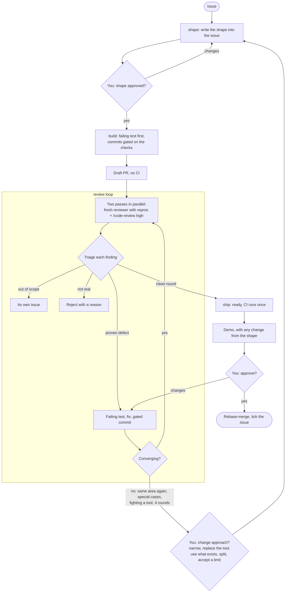

# shape-review-ship

Claude Code skills that take an issue from an agreed shape to a merged PR. Run the whole thing with `flow`, or each step on its own:

| Skill | Does | Waits for |
|---|---|---|
| `flow` | Runs the four below in order, picking up wherever the work is. Loops the reviews until a round is clean, and stops to ask after four rounds or when fixes keep opening new cases | your two approvals |

The four steps:

| Skill | Does | Waits for |
|---|---|---|
| `shape` | Writes what the change looks like, what's in and out of scope, and the tests, into the GitHub issue, and opens it for you | you to say "shape approved" |
| `build` | Builds it in small commits, failing test first, each commit gated on the project's checks, and opens a draft PR | nothing; hands over to `review` |
| `review` | Reviews the PR in a loop: a fresh reviewer that proves defects with repros, and `/code-review`, in parallel; fixes with failing tests first; re-reviews only what changed; steps back when fixes keep creating new edge cases | a clean round |
| `ship` | Marks the PR ready so CI runs once, gives you the demo with any differences from the shape, and rebase-merges | you to say "approve" |

The skills work on any project. They read its check commands and rules from its own `CLAUDE.md`.

## How it runs



`flow` runs all of it. Each box with "You" is where it stops and waits.

## Requirements

- **Claude Code.** Both reviewers come with it: the independent reviewer is its built-in general-purpose subagent, and the second pass is its `/code-review` skill. If your version has no `/code-review`, `review` runs a second fresh reviewer instead. Nothing else to install.
- **The GitHub CLI (`gh`), signed in** (`gh auth login`). The skills use it to read and edit issues, and to open, ready and merge PRs.
- **A `CLAUDE.md` in your project** that says how to run its checks.

## Install

In Claude Code:

```
/plugin marketplace add SvetHalachev/shape-review-ship
/plugin install shape-review-ship@shape-review-ship
```

Or from a terminal:

```sh
claude plugin marketplace add SvetHalachev/shape-review-ship
claude plugin install shape-review-ship@shape-review-ship
```

## Use

Ask in plain words ("shape issue 59", "run the review loop on PR 88"), or call a skill directly:

```
/shape-review-ship:flow 59      # the whole thing, from wherever issue 59 is
/shape-review-ship:shape 59
/shape-review-ship:build
/shape-review-ship:review 88
/shape-review-ship:ship 88
```

Give your project a `CLAUDE.md` that says how to run its checks (lint, types, tests, end-to-end), so `build` can gate commits on them and `review` can tell the reviewer how to run things.

`review` uses the `code-review` skill that comes with Claude Code.

## Updates

Every commit to this repo is a new version. Claude Code doesn't update plugins from GitHub on its own unless you turn it on:

- **Automatic:** run `/plugin`, open **Marketplaces**, pick `shape-review-ship`, and choose **Enable auto-update**. New versions arrive in the background; run `/reload-plugins` or restart to use them.
- **By hand:**
  ```sh
  claude plugin marketplace update shape-review-ship
  claude plugin update shape-review-ship@shape-review-ship
  ```
  then `/reload-plugins` in a running session.

## The flow, in short

1. **Shape** it in the issue. Nothing is built before it's approved.
2. **Build** it test-first, with every commit gated on the checks.
3. **Open a draft PR**, so CI doesn't run during review.
4. **Review** it twice in parallel, then triage: fix what's proven, reject what isn't with a reason, and move what's out of scope to its own issue.
5. **Re-review** only the commits that changed logic, telling the reviewers what's settled.
6. **Step back** when fixes keep opening new cases: change the shape instead of patching again.
7. **Ship**: ready, CI once, demo, approve, merge.
